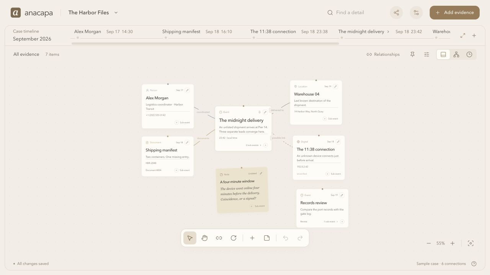

# Anacapa

Anacapa is a local investigation workspace with movable evidence cards, labeled threads, and nested timelines. Built with React, TypeScript, Vite, and a small Node.js server. No cloud services, analytics, or external APIs. Advanced cases use local accounts only.

**Runtime model:** the editing app needs its local Node server running. Browser installation adds an app window and shortcut; there is no service worker or cached editor that survives stopping the server. The exported HTML viewer works without Node or internet.

This repository contains the web/PWA implementation and its local server. The experimental native desktop prototype is excluded.



The illustrated user-guide example above uses fictional data. The guide screenshots are from version 0.3.3; the source and verification reports in this repository are version 0.4.1.

## Run from this repository

Use Node.js 22.13 or newer:

```sh
git clone https://github.com/sathyanarayanans940-cyber/anacapa-investigation-workspace.git
cd anacapa-investigation-workspace
npm ci
npm run build
npm start
```

The server opens a local browser window. To create the packaged folder described below, run `npm run package` after installing dependencies; packaging requires the `zip` command. No packaged binary is needed to run from source.

## Open the app

Install **Node.js 22.13 or newer** once. Unzip the Anacapa release folder into a location you can write to, then open:

- **macOS:** `Start Anacapa.command`
- **Windows:** `Start Anacapa.bat`
- **Linux:** run `sh start-anacapa.sh`

The launcher opens `http://127.0.0.1:5173` in your browser. Keep its terminal window open while using Anacapa. The release includes the built app and needs no npm installation or internet connection. You can also run `npm start` from this folder. If that port is occupied, set `ANACAPA_PORT` to another port before starting.

When you create or import a case, choose **Simple**, **Normal**, or **Advanced** and a parent folder on your computer. Anacapa creates a separate `Anacapa-<id>` case folder there. It contains the original attachments, permanent history, and recovery snapshots. Keep this entire folder. `.anacapa-data` inside the app folder stores the workspace registry and older cases, checkpoint signing identity, and separate journal records; keep it too. Older cases stay as they are; Case records → Save to a case folder creates a separate copy. Browser settings, including theme and icon, are remembered on the device. Anacapa binds only to this computer's loopback address. You can optionally install the browser's app shortcut; it still needs the local server running.

## Share an investigation

Open **Share** in the header:

- **Download to edit** produces a `.anacapa` file with the selected case content and attachments. Advanced cases always require a sharing passphrase. A recipient opens Anacapa, clicks the case name, and chooses **Open .anacapa file**. It adds a separate case and preserves their existing work.
- **Download to view** produces one self-contained `.html` file. Open it in a modern browser to inspect the evidence board, details, attachments, and nested timelines. It needs no Node.js, external account, app installation, or internet. Protected copies ask for the sharing passphrase and decrypt locally with Web Crypto. The Report view provides chronological details, citations, relationship sources, and a Print / save as PDF button. It is a read-only snapshot.

Share the release ZIP so others can use the app. Share a case file separately. By default each copy includes all nested items. Expand Choose cards & remove private details to select cards, exclude fields, or omit notes, sources, attachments, and the case description. Reduced copies exclude history and custody to avoid exposing removed information. Review text and images for identifying information before sharing; field exclusion does not scrub mentions elsewhere.

## A quick start

1. **Add evidence.** Give it a name, select a type, and add notes or a date if useful. Choose Custom type to use your own label.
2. **Connect the pieces.** Choose the link tool, click two cards, and name their relationship. Pick a Curved, Straight, Elbow, Spring, Wave, or Zigzag wire, then a named or custom colour. The previews show both together. Click an existing connection label, or its pencil in Relationships, to change its appearance later. Shapes and colours are preserved in editable files and HTML snapshots. Keep descriptive labels and use dashed lines for uncertain connections; wire shape is an independent visual choice. Old connections keep their original curve. In Select mode, drag cards or their relationship labels to arrange the board. Click a card to explore inside it; its pencil button edits the details.
3. **Follow time.** Click an event on the slim timeline to open its branch. Ancestors become compact lines. Use the expand arrow to fill the workspace with a timeline chart; Back to board restores the evidence board. Cards alternate above and below the line. Each card’s sliders menu chooses Above/Below and Card, Compact, or Note; these choices travel with shared cases.

4. **Go deeper.** Use the small plus in a card’s footer to create an event inside it. The editor shows the parent, and saving opens the new branch. Add sub-events to those cards again for more levels. Existing branches show an event count and an open arrow.

5. **Link different branches.** Open Relationships beside the view controls. New link searches every card in the current case and shows its branch path. Shared details suggests exact matching fields or tags across different branches; review a suggestion and save it deliberately. Cards with outside links show a link badge. Click an endpoint in Relationships to reveal its board. The Connect tool also offers Choose from any timeline after you select a source. Links do not move cards or combine timelines, and can connect the parent cards of two entire sub-timelines.

Optional sections in the editor contain timeline placement, custom detail fields, attachments, confidence, headline selection, tags, pins, and colors. Type dates as `YYYY-MM-DD HH:mm`, or use the matching calendar. Set a UTC offset under Timeline placement to order events consistently across zones. New cards start with the computer’s current offset. Original source timestamps and exact / approximate / date-only precision can be recorded separately. A blank offset uses the computer’s local zone. The timeline orders events chronologically with equal spacing; it is not an elapsed-time scale.

The bottom toolbar offers Select, Pan, Connect, and Tilt. Hover or focus for labels. Select moves one card; Pan moves the entire board. Tilt intentionally rotates a selected card in 1° steps, up to 15° each way. Undo/redo keeps the latest 40 actions in a session. Settings provides light, dark, and system appearance, palettes, and app icons.

Board zoom accepts an exact percentage from **5% to 400%**. Type it in the lower-right control and press Enter, or use +/− for ten percentage points. **Lock zoom** keeps the current percentage through navigation, filters, window resizing, and reopening on this device. Pan still works; **Center board** recentres at the locked scale. Unlock to zoom again. With zoom unlocked, **Fit board** (F) shows the visible cards and labels. Trackpad pinch zooms around the pointer; ordinary two-finger scrolling pans. The expand icon hides the header and timeline ribbon for more room; press Escape or the restore icon to return. The board has no fixed canvas edge: pan to reach other areas instead of shrinking every card to fit on one screen. Viewing controls do not modify evidence or saved positions.

Scrollbars throughout the editor and newly exported HTML viewers use the active palette’s accent colour with a transparent track. Existing HTML snapshots keep the styles embedded when they were exported; download a new viewer to get appearance updates.

Card colours describe two independent things: the colour family follows the evidence **type**, while shade strength follows **Unverified**, **Likely**, or **Confirmed** confidence. **Custom types** get their own consistent muted colour from the type name; the same name keeps its colour across cases, themes, and newly exported HTML. A priority pin adds a stronger border and a **Priority** label without changing the confidence shade. Text labels and status marks keep the meaning readable without relying on colour alone. Use the pencil → **Card appearance & labels** to change Confidence or **Pin as priority**. These are user-recorded assessments, not automatic verification of evidence.

On narrow screens, the header’s magnifying glass opens evidence search. The labelled **Timeline** tab opens the chart; choose **List** for a compact chronological view. Search includes nested cards, and Clear search restores the branch. Ctrl/⌘ K opens the appropriate search control at any width.

For larger cases, keep the main board focused on the key events and group nearby people, places, documents, and devices around them. Put detailed sequences inside their parent cards, then use Relationships to link shared evidence across branches. The board is freely arranged; synthetic benchmark grids do not set its layout. Showing every item and link at once will become crowded, so use nested boards, search, and filters as a case grows.

The initial Harbor Files example is fictional. Create a new case from the case menu. Workspace backup exports only Normal case JSON references without attachment bytes. Advanced cases are excluded. Use `.anacapa` files for sharing and Case records → Make a complete backup to preserve originals, all snapshots, accounts, and history.

Open **Help** in the lower-right corner to download the illustrated **28-page user guide** and **Harbor Tutorial practice case**. The guide covers boards, nested timelines, cross-timeline relationships, case folders, security modes, sources, integrity, custody, history, backups, selective sharing, limits, and recovery. It includes sharp real screenshots from version 0.3.3, a clickable contents page, and current chapters explaining the new controls and Review tools. The **Case folders & security guide** in Help remains a quick reference for those workflows and deployment limits. These files also live in `dist/guide/Anacapa-Guide.pdf` and `dist/examples/Harbor-Tutorial.anacapa` in the release folder.

## Controls and protection

**Simple** is the easiest starting point: cards, dates, attachments, nested timelines, basic connections, and undo/redo. Optional card fields appear under **More fields & sources**. Tilt, filters, pins, Add note, and the Relationships browser are available by choosing **Settings → Case controls → Full**. Existing data and links are preserved when changing controls.

In **Select**, drag a card’s lower-right corner to change its width and height. Compact cards show the title and pencil; wider/taller cards reveal more preview text. The full evidence remains available inside the card and editor. Double-click the grip to restore automatic size, or use **Card appearance & labels → Reset card size** in the editor. A focused grip supports arrow keys, Shift for ten pixels, and Home to reset. Escape cancels a drag. Sizes are independent, support Undo/Redo, and save with the case, `.anacapa` files, and newly exported HTML. Board sizing does not change timeline card styles.

**Normal** exposes the full controls without passwords or required change reasons. **Advanced** adds encryption, local roles, locking, and change reasons. An Advanced case can also use Simple controls from Settings without weakening its protection. Simple at creation uses Normal protection; the control preference never changes security mode.

## Security modes and case records

| Capability                                               | Normal              | Advanced                                                       |
| -------------------------------------------------------- | ------------------- | -------------------------------------------------------------- |
| Chosen case folder, preserved originals, saved revisions | Yes                 | Yes                                                            |
| Sources and citations on cards and relationships         | Optional            | Optional; record sources for consequential claims              |
| SHA-256 checks and recovery snapshot verification        | Yes                 | Yes                                                            |
| Signed checkpoints outside the case folder (new cases)   | Yes                 | Yes                                                            |
| Encryption of case content, originals, metadata, history | No                  | AES-256-GCM                                                    |
| Local account roles                                      | No password prompts | Administrator, Editor, Viewer                                  |
| Automatic lock                                           | No                  | 10 minutes without interaction; server restarts lock all cases |
| Reason for changes to evidence                           | Optional            | Required; layout-only changes are exempt                       |
| Shared .anacapa and HTML copies                          | Plain or protected  | Always protected                                               |

The shield button in the header opens **Case records**. Its **Storage** tab shows current case-folder bytes grouped into originals, recovery snapshots, history, and metadata, plus the separate checkpoint journal. It is read-only and never prunes evidence. External backup copies and the app registry/signing key are excluded. Full snapshots accumulate on each save; inspect storage regularly on long-running cases. History records the time, operator, action, and reason. Restore creates a new revision and preserves earlier entries. Sources retain exhibit references, document pages or recording timestamps, collection context, and the statement supported. Uploads preserve original bytes and record the app intake time, operator, size, and SHA-256 hash; source collection times are separate user-entered records.

Integrity checks cover the current and historical recovery snapshots, the audit hash chain, and all recorded original attachments, including originals no longer attached to a visible card. Advanced mode additionally checks authenticated encryption and keyed history signatures. Download an integrity receipt and keep it separately. New folder-backed cases sign every saved checkpoint with Ed25519 and compare the current head against records outside the case folder. Review can compare a saved receipt against the current or an earlier revision. Custody records capture the reported sender, recipient, time, method, and purpose, with the recording operator and time added automatically.

An Administrator can add Editor and Viewer accounts and revoke them. A Viewer cannot change case records through the server API. Revocation ends that local account’s active sessions; it cannot revoke information already read, photographed, or exported. Passphrases are not stored in browser storage. Each local account wraps the case encryption key with a key derived by PBKDF2-SHA256, using a random salt and 600,000 iterations. Keep passphrases safe: there is no external recovery service or password reset.

A case folder contains `case.json` (mode and account key envelopes), `head.json` (current checkpoint), `snapshots/`, `audit/`, and `originals/`. Advanced contents are encrypted; folder identifiers, account names, roles, mode, and checkpoint metadata are visible. Do not edit these files manually. There is no automatic purging of originals or saved revisions. Watch disk space on long-running cases.

Administrators and Editors can use **Make a complete backup** to copy the entire case folder to another location. Viewers can export protected copies instead. A completed backup records its time and revision in the active case history afterward. Advanced backups remain encrypted. Copy to another drive for protection from device loss. In a fresh app, choose **Open case folder** and select the restored folder; Advanced cases still need a valid local account. Keep the active folder intact while backing it up. A backup has its earlier checkpoint; replacing an active folder with it triggers rollback detection. For disaster recovery, open it in a fresh installation and compare the receipt using a fingerprint retained independently. Configure new checkpoints there after review. Use History restore for ordinary mistaken edits. `.anacapa` imports start a new local history chain and retain supplied custody and earlier audit entries as source records; earlier imported entries are not local recovery snapshots.

These are local application safeguards, not a CJIS certification, an independent forensic validation, or an agency-approved evidence system. Normal folders are readable by anyone with disk access. Advanced cases are visible in memory while unlocked. A compromised computer, an administrator with the key, or a person holding an unlocked case can bypass or copy information. Keep verification receipts separately; the app cannot establish an external trusted timestamp, prove a reported physical custody transfer, or protect against compromise of the signing key and trusted checkpoint records together. Rewriting or rolling back only a case folder is detected against its separate journal and pinned signing identity. Use device encryption, OS account separation, independent backups, and your organization’s policies for sensitive work. Creating an Advanced copy does not erase or encrypt earlier unprotected copies.

## Separate checkpoints and case review

Open **Case records → Review**. Every new case starts with a signed journal outside its case folder, under `.anacapa-data/checkpoints/`. The app stores its Ed25519 private signing key and pinned latest records in `.anacapa-data`; the private key is never packaged or included in a case export. An Administrator can relocate the journal to a separate drive or folder while preserving the signing identity and chain. Older or freshly attached folders can enable a new baseline here. This baseline covers subsequent revisions; it cannot independently validate earlier untrusted history.

Editing stops if the checkpoint journal is unavailable or the case differs from its trusted latest record. Reconnect the original location before retrying; preserve unsaved changes. Recovery can finish a signed pending save if the staged snapshot, audit entry, and separate journal all match. A missing private key is not silently regenerated for existing checkpointed cases. Preserve the app data and journal on trusted backups.

Use **Integrity → Download verification receipt**, retain it independently, and use **Review → Compare a saved receipt** later. A valid signature must also match this installation's pinned key. A new installation opening a backup has no pin and explicitly reports that limitation; confirm its fingerprint with the sender through a separate trusted channel. The included read-only command compares a current folder head with a signed receipt without decrypting the case:

```sh
node runtime/verify-checkpoint.mjs CASE_FOLDER RECEIPT_JSON TRUSTED_KEY_FINGERPRINT
```

That command checks the signature and current head only; run the app's full Integrity check for originals and history. The fingerprint must come from an independent trusted record, not solely from the receipt being checked. Checkpoints contain revision IDs and hashes, not evidence text. Local signatures have no external trusted timestamp. Someone who controls the whole computer, signing key, journal, and pinned registry can defeat these checks.

**Case handling** records an owner/team, procedure reference, review date, backup interval, retention hold, and handling instructions. Administrator updates are audited. Editors and Viewers can read them. These are documented procedures and reminders: the app does not schedule backups, erase evidence, enforce OS retention, or obtain agency approval.

**Download case review** reports current integrity, checkpoint identity, citation and explicit time-zone coverage, handling settings, and backup status. Counts do not establish source quality. **View release test results** opens a source-fingerprinted developer validation report; it explicitly distinguishes completed automated checks from pending visual, independent security, and agency reviews.

## Develop from source

```sh
npm ci
npm run build
npm start
```

For live development after the initial build, use `npm run dev`. Changes to the runtime model require `npm run build` again.

```sh
npx playwright install chromium
npm run validate
npm run package
```

`npm run validate` builds the production app, runs formatting and TypeScript checks, all Node tests (including PWA manifest/icons), and the isolated Chromium browser workflows, then writes `public/validation/report.html` and `report.json`. It fails instead of generating a passing report when a check fails. The report records its tested source SHA-256, version, platform, and scope. It is developer validation, not independent certification. Run it before packaging. The browser download is a development/test dependency; recipients of the release do not need Playwright. See [repeatable verification](docs/Verification.md) and the [source map](docs/Architecture.md). GitHub Actions runs these checks on Windows and Linux after a push; inspect the actual workflow result before claiming CI passed.

`npm run package` builds a ready-to-run folder and `release/Anacapa.zip` (requires the `zip` command). Packaging uses an explicit file allowlist and excludes user data, local service state, dependencies, and Git metadata. `.anacapa-data`, generated releases, and other local state are ignored by Git. Never commit your investigation data.

## Limits

Up to 100 cases, 3,000 nodes and 6,000 connections per case, with an 80 MB workspace request limit. Attachments are up to 10 MB each. Portable cases include up to 50 MB of attachment bytes and accept plain files up to 75 MB or protected files up to 100 MB. Concurrent windows use revision checks so one cannot silently overwrite a newer save. Large graphs are not virtualized. [Measured scale results](docs/Performance.md) cover 100–3,000 cards on an M3 Max, with nested and flat layouts; they do not establish low-end-hardware performance. Sharing is through snapshots and files; there is no live collaborative editing.

Installed Dock icons are controlled by the browser and OS. In-app and browser-tab icons follow theme changes immediately; Dock updates may require the browser's app-update confirmation.

If another window saves first, use **Save conflict · Recover** to download this window's unsaved work as a `.anacapa` recovery copy. Download a copy of each case you changed before choosing **Load latest**. Advanced recovery copies stay protected; server history and custody are excluded from these copies.

If a case folder is unavailable, the other cases remain usable. Reconnect its drive and choose **Retry folder**, or use **Locate moved case folder** if its original location no longer exists. Damaged records are kept intact for recovery; the app does not silently replace them.
